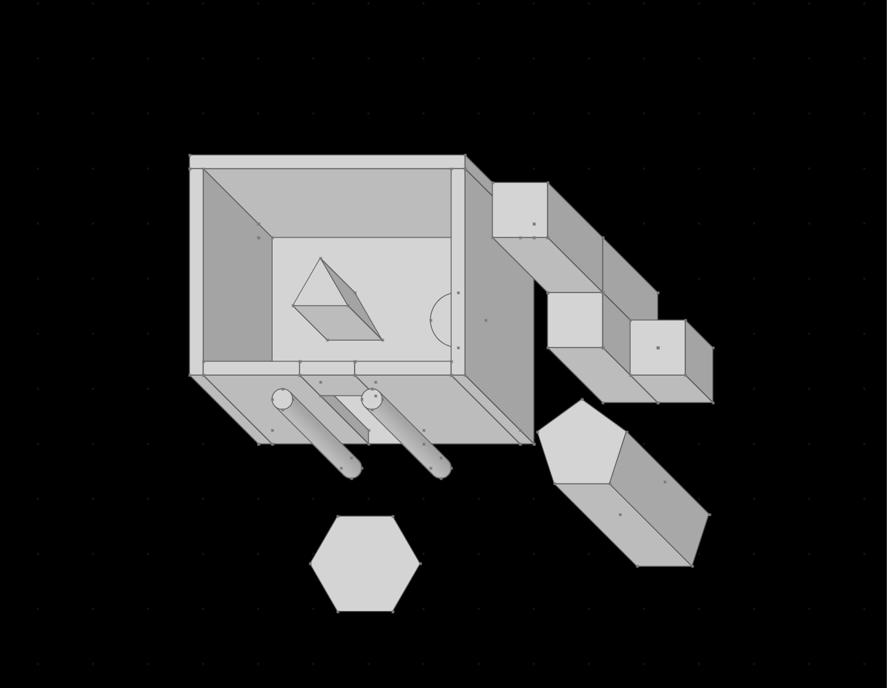
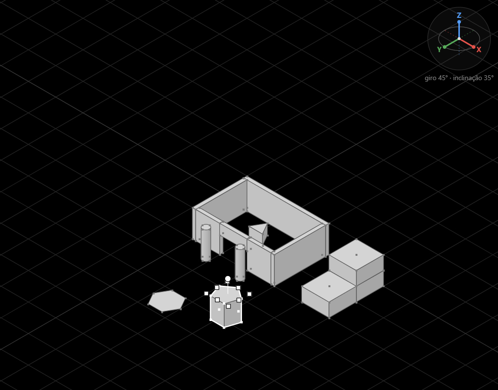

# Esquadro — editor com blocos

Editor de arquitetura para jogos em grade: monte casas, muros e construções empilhando formas geométricas que se encaixam pelos vértices. Roda no navegador, sem instalação, sem build e sem dependências.

## Como abrir

Baixe a pasta e abra `index.html` no navegador (duplo clique basta). Tudo é HTML, CSS e JavaScript puro, com Canvas 2D.

## O que dá para fazer

- **Formas:** polígonos regulares de 3 a 48 lados (32 px por lado) e círculos (32 px de diâmetro). Um clique no painel cria.
- **Esticar e dar espessura:** as alças esticam em X e Y; a alça redonda dá espessura em Z e transforma a forma num volume.
- **Encaixe:** vértices próximos se encaixam e as peças encaixadas passam a se mover juntas. Também há encaixe na grade (tiles de 64 px), com vértices e meio dos lados. Cada assistente pode ser desligado.
- **Vistas:** a oblíqua de jogo em grade (a altura sobe na diagonal), topo, isométrica e giro livre segurando o botão da roda, com um ícone que mostra a orientação e trava opcional em múltiplos de 45°.
- **Seleção:** clique marca a forma (em azul), `Ctrl`+clique marca várias; o grupo inteiro vem junto, ou só as peças, com "Selecionar desacoplado".
- **Mesclar:** marque duas ou mais formas com Ctrl+clique e use Mesclar no botão direito. Sólidos podem se encontrar por parte de uma face ou se sobrepor, inclusive arcos e paredes perpendiculares. A união remove superfícies internas e preserva as aberturas restantes. Peças separadas, abertas ou em contato só por ponto/aresta são recusadas. Ctrl+Z restaura as peças originais.
- **Recortar área:** com `Shift`, marque vértices de uma forma; a área entre eles (em vermelho) pode ser recortada.
- **Vazar pela face:** encoste uma face de um bloco ou volume na face de uma parede e selecione o bloco que servirá de molde. Use **Vazar pela face** no botão direito ou na barra superior para abrir um vão no formato exato dessa face, atravessando a parede inteira. A parede conserva sua cor, o molde é preservado e fica selecionado de forma desacoplada: mova-o para ver a abertura. `Ctrl+Z` desfaz. Se o molde encostar em mais de uma parede compatível, clique naquela que deve receber o vão; `Esc` cancela essa escolha.
- **Rotacionar:** 90°, 180° e 270° em X, Y ou Z; um prisma deitado de lado vira rampa ou telhado.
- **Formas livres em 3D:** duplo clique num vértice o prende ao cursor; ele pode ir a qualquer ponto, inclusive a um vértice de outra altura, e a forma se deforma (pirâmides, telhados inclinados).
- **Cor e filtro:** pinte as formas com qualquer cor (paleta do sistema ou hexadecimal) e esconda ou mostre formas por cor.
- **Régua:** clique em dois vértices para medir a distância em 3D, em px e em tiles.
- **Biblioteca:** salve peças com nome e coloque cópias no desenho; exporte e importe a biblioteca como JSON.
- **Cenas:** `Ctrl+S` salva e `Ctrl+O` carrega (no Chrome e no Edge, `Ctrl+S` grava de novo no mesmo arquivo).

Na primeira visita, um **guia passo a passo** destaca cada parte da tela e explica o que ela faz; ele volta pelo botão de bússola no topo do painel. A tecla `?` mostra todos os atalhos.

O comando **Vazar pela face** reconhece contato real em 3D, em qualquer vista da câmera. O alvo pode ser um prisma de seção constante ou uma malha extrudida com o mesmo perfil nas duas faces, inclusive contornos côncavos e portais (eixos X, Y ou Z). O molde deve encostar por uma face real, sem folga nem penetração. O contorno de contato é subtraído da seção: pode criar um vão interno, um entalhe aberto, unir-se a um vão existente ou dividir a parede em várias partes. As partes restantes e o molde ficam na cena; Ctrl+Z desfaz tudo. São aceitos moldes poligonais, circulares (com a aproximação do editor) e faces planas de malhas. Alvos deformados que não sejam prismas extrudidos, cortes inclinados e contatos só por aresta ou ponto ainda não são suportados.

## Arquivos

- `index.html`: página e painel.
- `geometria.js`: formas, vértices, câmeras, encaixes, mescla, recorte, giro e malhas 3D. Sem acesso ao DOM; também roda no Node.
- `editor.js`: visualizador e interação.
- `guia.js`: o guia passo a passo.
- `testes.cjs`: testes da geometria, com `node testes.cjs`.

## Licença

MIT. Veja `LICENSE`.

### Vértice relativo e segundo clique

Marque um único vértice com Shift+clique e escolha **Criar vértice relativo…** no botão direito. Informe ΔX, ΔY e ΔZ em pixels do mundo; o ponto deve ser novo e estar numa face plana ligada à origem. A forma vira uma malha editável, e o vértice criado pode ser arrastado com duplo clique. Ctrl+Z desfaz. Formas com furos fechados aceitam pontos nas tampas e nas paredes internas; pontos no vazio do furo são recusados.

O primeiro clique numa peça agrupada seleciona o grupo; outro clique na mesma peça seleciona apenas ela. Arrastar continua movendo a seleção atual; ao mover uma peça selecionada sozinha, ela sai do grupo conforme o comportamento de Selecionar desacoplado.

A triangulação de faces com furos usa Earcut 3.0.2, incluído localmente em earcut.js sob licença ISC (earcut-LICENSE.txt), sem depender de acesso à rede.

União booleana de sólidos usa CSG.js de Evan Wallace, incluído localmente sob licença MIT (csg-LICENSE.txt).

